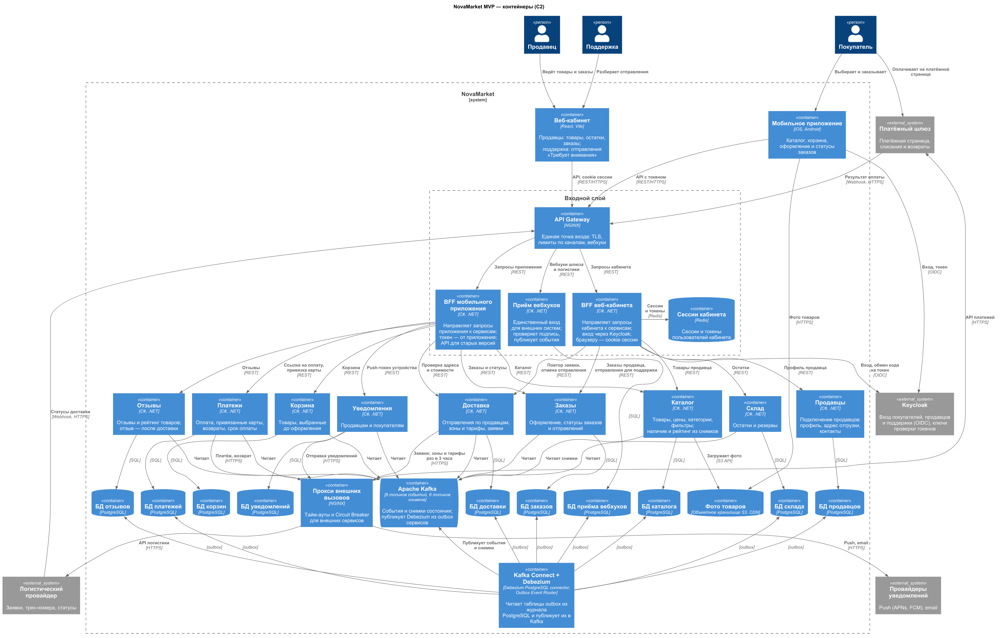
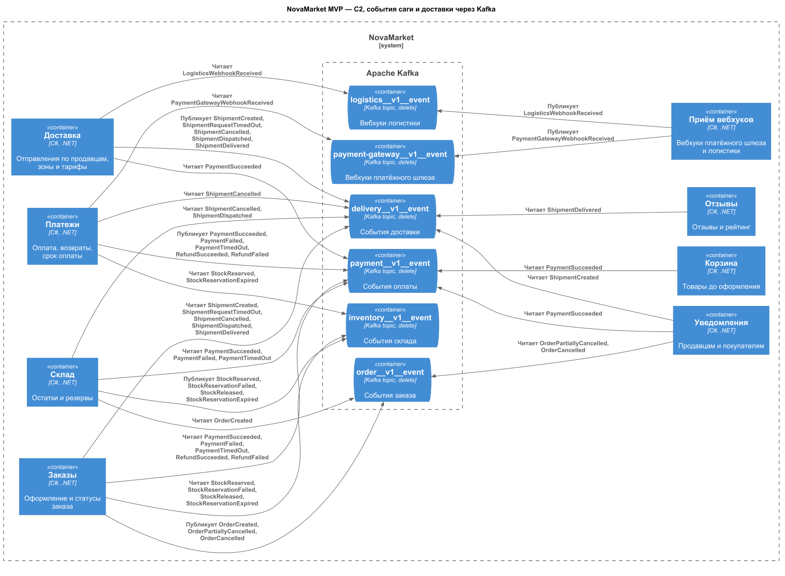
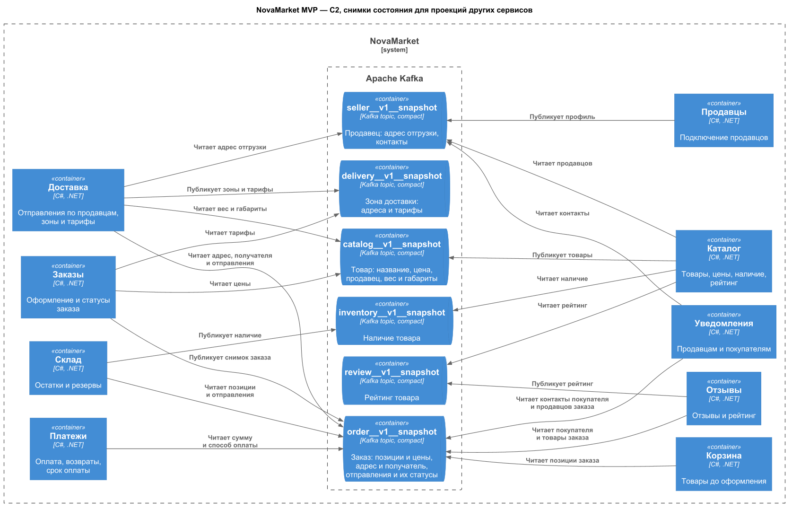
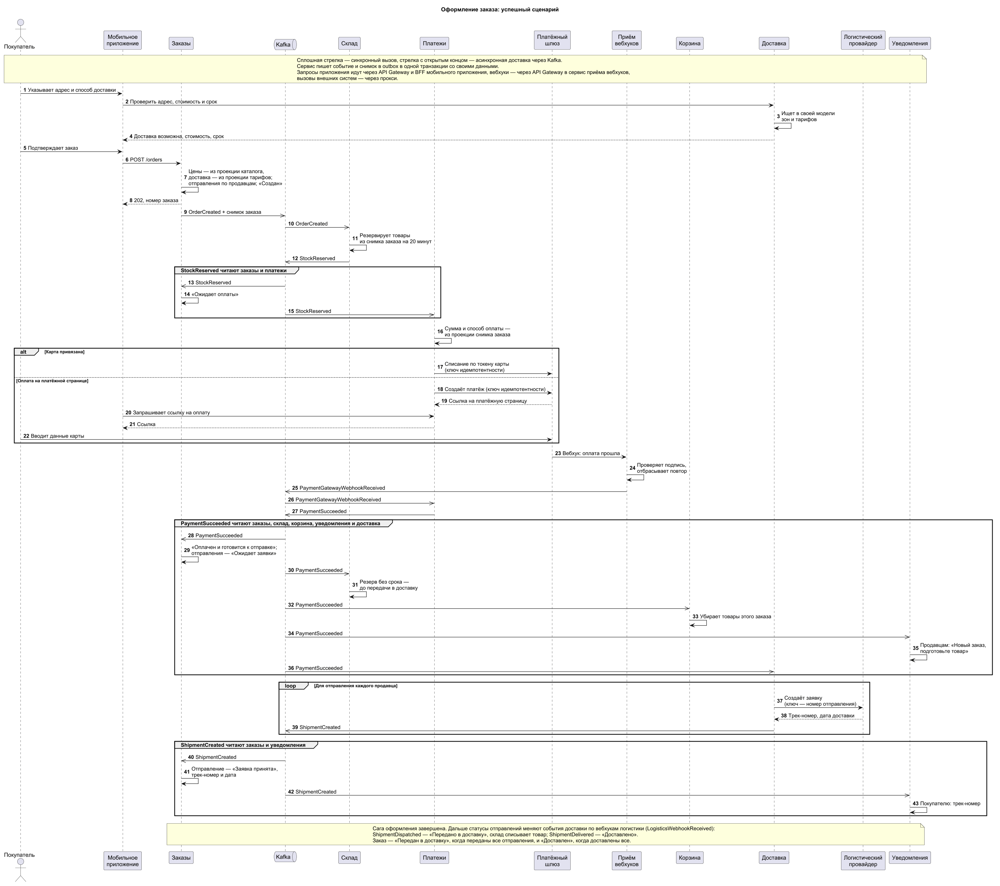
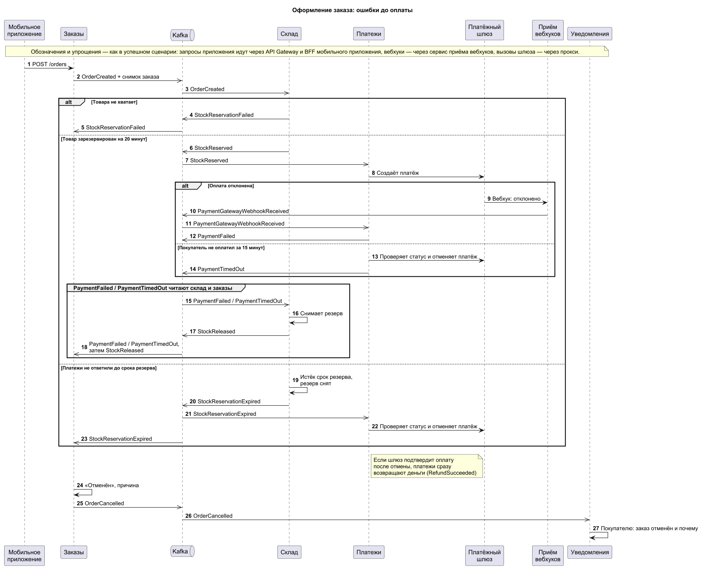
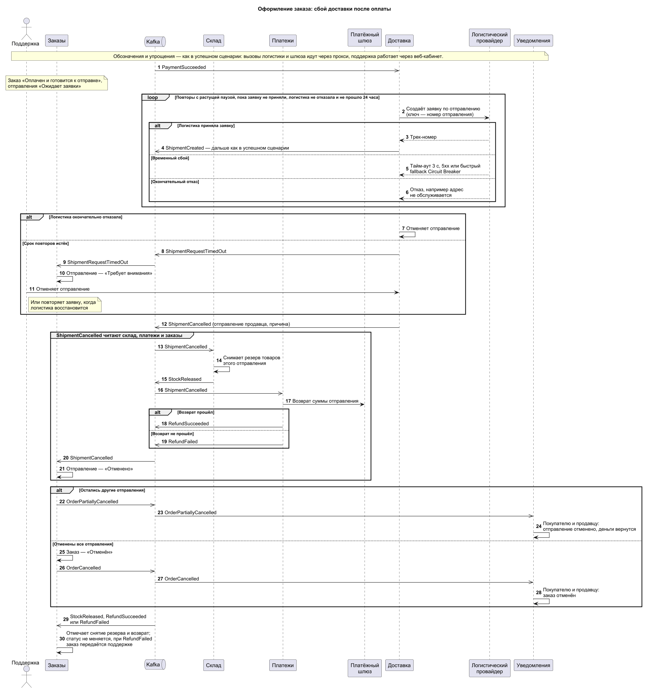

# Задание 1. Событийная архитектура NovaMarket

MVP: покупатели заказывают через мобильное приложение, продавцы и поддержка работают в веб-кабинете. Вход — через Keycloak (OIDC). Бэкенд — девять доменных сервисов на .NET, у каждого своя база PostgreSQL. На входе — два BFF, мобильного приложения и веб-кабинета, и сервис приёма вебхуков от внешних систем. Сервисы обмениваются через Kafka событиями и снимками состояния; в Kafka их публикует Debezium из таблиц outbox сервисов. NGINX работает входным API Gateway и отдельным прокси для вызовов внешних сервисов: платёжного шлюза, логистики, провайдеров уведомлений.

## Схема C2

C2 разделена на три схемы: общая, события и снимки.

Общая: входной слой — API Gateway и BFF клиентов, — сервисы, их базы, синхронные вызовы, публикация через Debezium и внешние системы ([c2-containers.puml](c2-containers.puml)).



События саги и доставки по топикам ([c2-events.puml](c2-events.puml)).



Снимки состояния, из которых сервисы строят свои проекции ([c2-snapshots.puml](c2-snapshots.puml)). Здесь и на виде событий «Публикует» — логическая связь: сервис пишет запись в свою таблицу outbox, а в топик её доставляет Debezium.



| Сервис | Назначение | Публикует | Читает |
| :- | :- | :- | :- |
| Каталог | Товары, цены, категории, поиск с фильтрами | снимок товаров | снимки наличия, рейтинга, продавцов |
| Отзывы | Отзывы и рейтинг; отзыв — после доставки | снимок рейтинга | `ShipmentDelivered`, снимок заказа |
| Продавцы | Подключение продавца: профиль, адрес отгрузки, контакты | снимок продавца | — |
| Корзина | Товары до оформления заказа | — | `PaymentSucceeded`, снимок заказа |
| Заказы | Оформление, статусы заказов и отправлений для покупателя, продавца и поддержки | `OrderCreated`, `OrderPartiallyCancelled`, `OrderCancelled`, снимок заказа | `StockReserved`, `StockReservationFailed`, `StockReleased`, `StockReservationExpired`, `PaymentSucceeded`, `PaymentFailed`, `PaymentTimedOut`, `RefundSucceeded`, `RefundFailed`, `ShipmentCreated`, `ShipmentRequestTimedOut`, `ShipmentCancelled`, `ShipmentDispatched`, `ShipmentDelivered`, снимки товаров и тарифов |
| Склад | Остатки и резервы | `StockReserved`, `StockReservationFailed`, `StockReleased`, `StockReservationExpired`, снимок наличия | `OrderCreated`, `PaymentSucceeded`, `PaymentFailed`, `PaymentTimedOut`, `ShipmentCancelled`, `ShipmentDispatched`, снимок заказа |
| Платежи | Оплата через шлюз, привязанные карты, возвраты, срок оплаты | `PaymentSucceeded`, `PaymentFailed`, `PaymentTimedOut`, `RefundSucceeded`, `RefundFailed` | `PaymentGatewayWebhookReceived`, `StockReserved`, `StockReservationExpired`, `ShipmentCancelled`, снимок заказа |
| Доставка | Отправления по продавцам, зоны и тарифы, заявки в логистику, статусы | `ShipmentCreated`, `ShipmentRequestTimedOut`, `ShipmentCancelled`, `ShipmentDispatched`, `ShipmentDelivered`, снимок тарифов | `LogisticsWebhookReceived`, `PaymentSucceeded`, снимки заказа, товаров и продавцов |
| Уведомления | Push и email продавцам и покупателям | — | `PaymentSucceeded`, `ShipmentCreated`, `OrderPartiallyCancelled`, `OrderCancelled`, снимки заказа и продавцов |
| Приём вебхуков | Единственный вход для внешних систем: вебхуки платёжного шлюза и логистики, проверка подписи, отсев повторов | `PaymentGatewayWebhookReceived`, `LogisticsWebhookReceived` | — |

## Топики, события и снимки

Топики названы по шаблону `<домен>__v<версия>__<тип>`. Пишет в топик только сервис — владелец домена.

| Топик | Тип | Ключ | Хранение | Содержимое |
| :- | :- | :- | :- | :- |
| `order__v1__event` | события | номер заказа | 7 дней | события заказов |
| `inventory__v1__event` | события | номер заказа | 7 дней | события склада |
| `payment__v1__event` | события | номер заказа | 7 дней | события платежей |
| `delivery__v1__event` | события | номер заказа | 7 дней | события доставки |
| `payment-gateway__v1__event` | события | номер заказа | 7 дней | вебхуки платёжного шлюза после проверки подписи |
| `logistics__v1__event` | события | номер заказа | 7 дней | вебхуки логистики после проверки подписи |
| `order__v1__snapshot` | снимки | номер заказа | компактирование | покупатель; дата оформления; позиции: товар, продавец, количество, название и цена на момент покупки; сумма; адрес; получатель — имя и телефон; email покупателя, который заказы берут из его токена; способы доставки и оплаты; отправления по продавцам с суммой, статусом, трек-номером и датой доставки |
| `catalog__v1__snapshot` | снимки | товар | компактирование | название, цена, продавец, вес и габариты |
| `inventory__v1__snapshot` | снимки | товар | компактирование | наличие |
| `review__v1__snapshot` | снимки | товар | компактирование | рейтинг |
| `seller__v1__snapshot` | снимки | продавец | компактирование | адрес отгрузки, контакты |
| `delivery__v1__snapshot` | снимки | зона доставки | компактирование | обслуживаемые адреса и тарифы |

- События — тонкие факты: номер заказа или отправления, версия снимка заказа и данные самого факта, например причина отказа или трек-номер. Остальное потребитель берёт из своих проекций. События хранятся 7 дней: за это время потребитель успевает догнать поток после простоя.
- Снимок — текущее состояние сущности. Топики снимков компактируются: в них остаётся последняя версия каждой сущности. По ним каждый сервис строит свои таблицы-справочники вместо синхронных запросов к владельцу данных. Версия снимка растёт с каждым изменением, и потребитель применяет снимок, только если его версия новее сохранённой.
- Цена и название в снимке заказа — на момент покупки: в каталоге они потом меняются.
- Удалённая сущность, например ушедший с площадки продавец, публикуется пустым значением по своему ключу (tombstone). У топиков 3 реплики, запись подтверждается при `min.insync.replicas=2`. Каждый сервис читает топик своей группой потребителей, и его реплики делят партиции между собой. Несовместимое изменение схемы выходит в новом топике `__v2__`.
- Проекции снимка заказа в других сервисах хранят заказ, пока он нужен для их шага: заказ в финальном статусе удаляется из проекции через 90 дней.

Сервис начинает обслуживать запросы, только когда дочитал снимки справочников до конца топика на момент запуска. Если событие пришло раньше снимка нужной версии, сервис ждёт снимок и только потом выполняет свой шаг. Ожидание ограничено сроком: не дождавшись снимка, сервис отправляет событие с причиной в `<имя топика>__dlq`, и его разбирают вручную.

Каждое событие несёт `eventId`, `eventType`, версию схемы, `sagaId` (номер заказа), `correlationId` (запрос покупателя, для трассировки), `timestamp` и данные факта:

```json
{
  "eventId": "6f1c2e0a-4b7d-4c1e-9a55-0d3f8b2a7c11",
  "eventType": "PaymentSucceeded",
  "schemaVersion": 1,
  "sagaId": "order-100245",
  "correlationId": "req-8f3a91",
  "timestamp": "2026-11-16T12:34:56Z",
  "payload": { "orderId": "100245", "orderVersion": 1, "paymentId": "pay-7781" }
}
```

## Сага оформления заказа

Реализация саги — хореография: асинхронный обмен через Kafka и согласованность в конечном счёте. Каждый сервис реагирует на события и сам компенсирует свой шаг, общего оркестратора нет. Почему этот вариант подходит:

- Шагов немного — склад, платежи, доставка, — и каждый целиком принадлежит одному сервису. Оркестратор добавил бы ещё один сервис и ещё одну точку отказа, ничего не упростив.
- Покупатель не ждёт всей цепочки: оформление сразу отвечает `202`, а оплата и заявка в логистику зависят от внешних систем и могут занять минуты и часы.
- Атомарная транзакция между сервисами не нужна: заказ проходит статусы по событиям, а расхождения закрывают компенсации до оплаты и повторы после неё.

Цена выбора — процесс не виден целиком в одном месте, поэтому заказы собирают статус заказа из событий всех шагов и показывают поддержке зависшие саги. Если шагов станет заметно больше, следующий шаг — оркестратор.

Заказы только ведут статусы и сообщают об отмене: `OrderPartiallyCancelled` — когда отменено одно из отправлений, `OrderCancelled` — когда отменён весь заказ. Эти события читают только уведомления, откатом на них никто не отвечает.

Шаги саги делятся на три типа:

- **Компенсируемые** — создание заказа и резерв товара. Если до оплаты что-то пошло не так, их компенсируют: склад снимает резерв, платежи отменяют платёж, заказ отменяется.
- **Точка невозврата** — оплата. После `PaymentSucceeded` сага идёт только вперёд.
- **Повторяемые** — заявка в логистику, отправка и доставка. При сбое их повторяют, а не откатывают.

Если после оплаты отправление всё же отменили — логистика окончательно отказала или так решила поддержка, — сагу уже не откатывают, а запускают отдельный процесс возврата: это компенсация новыми действиями, когда платежи возвращают деньги через шлюз, а склад снимает резерв товаров этого отправления. Когда он запускается, сказано в правилах ниже.

Правила:

- Сервисы не вызывают друг друга синхронно. Чужие данные сервис берёт из своих таблиц, построенных по снимкам, а шаг в другом сервисе запускает своим событием. Снаружи в NovaMarket входят только через API Gateway: клиенты — в свои BFF, внешние системы — в сервис приёма вебхуков. Синхронно в доменные сервисы ходят только BFF. Сами сервисы и их служебные воркеры ходят синхронно только во внешние системы через прокси внешних вызовов — он здесь шлюз интеграции. Например, доставка раз в три часа забирает у логистики зоны и тарифы.
- Сервис меняет свои данные и записывает событие и снимок в таблицу outbox в одной транзакции. В Kafka их публикует готовый Debezium — PostgreSQL connector в Kafka Connect с Outbox Event Router. Он читает новые записи outbox из журнала PostgreSQL в порядке коммитов и отправляет каждую в топик, указанный в записи, с ключом — идентификатором сущности. Свой код сервиса — только состав событий и снимков. Позицию в журнале Debezium сохраняет после подтверждения брокера, поэтому сообщение может уйти дважды, но не потеряется: `eventId` события — это идентификатор строки outbox, и по нему потребитель отсекает повтор. Старые строки outbox сервис удаляет периодической задачей.
- Потребитель записывает `eventId` в таблицу обработанных событий в одной транзакции со своим результатом и пропускает повтор. Ненужные ему типы событий из топика он тоже пропускает. Сообщение, которое не удалось обработать после нескольких повторов с паузой, уходит с причиной в топик `<имя топика>__dlq` и разбирается вручную.
- Ключ сообщения — идентификатор сущности: номер заказа для событий саги, товар — для снимков товара и наличия. Поэтому внутри топика сообщения одной сущности идут по порядку. Между топиками порядок не гарантирован, поэтому статусы меняются только по таблице переходов ниже.
- Адрес проверяется до оформления. Когда покупатель выбирает способ доставки, приложение спрашивает сервис доставки, обслуживается ли адрес и сколько стоит доставка. Ответ сервис берёт из своей модели зон и тарифов, которую раз в три часа обновляет у логистики. Ту же модель доставка публикует снимком тарифов, и заказы считают по нему стоимость доставки при оформлении. Пока покупатель оформляет заказ, логистику синхронно никто не вызывает.
- Цены заказы берут из своей проекции каталога. Приложение передаёт цены, которые видел покупатель. Если цена успела измениться, заказы отвечают `409` с новой ценой, и покупатель подтверждает её. Наличие точно проверяет склад при резерве.
- Один заказ может включать товары нескольких продавцов. Оплата одна, а доставка идёт отдельным отправлением на каждого продавца со своим статусом. Продавец получает уведомление сразу после оплаты, чтобы начать сборку, не дожидаясь ответа логистики.
- Резерв не висит бесконечно. Не оплачено за 15 минут — платежи публикуют `PaymentTimedOut`. На случай, если платежи не ответили, у резерва свой срок, 20 минут: по нему склад снимает резерв и публикует `StockReservationExpired`. После `PaymentSucceeded` срок у резерва снимается: товар ждёт продавца, пока отправление не передадут в доставку. Склад снимает просроченный резерв, только когда отставание его группы потребителей по `payment__v1__event` равно нулю, иначе ждёт следующего запуска задачи: так оплату, прошедшую до срока, он увидит раньше. Платёж после `PaymentTimedOut` или `StockReservationExpired` закрыт: если шлюз всё же подтвердит оплату, платежи не публикуют `PaymentSucceeded`, а сразу возвращают деньги.
- После оплаты временный сбой логистики не отменяет заказ: доставка повторяет заявку с растущей паузой. Если заявку не приняли за 24 часа, отправление получает статус «Требует внимания». Поддержка в веб-кабинете повторяет заявку, когда логистика восстановится, или отменяет отправление. Когда отправление отменено — логистика окончательно отказала или его отменила поддержка, — доставка публикует `ShipmentCancelled`: склад снимает резерв его товаров, платежи возвращают его сумму.
- Сроки хранятся в данных: у платежа — срок оплаты, у резерва — срок резерва, у отправления — срок повторов заявки. Периодическая задача в сервисе-владельце находит просроченные записи, меняет их статус и пишет событие в outbox в одной транзакции. Так же заказы находят зависшие саги, например заказ дольше 5 минут в статусе «Создан», и показывают их поддержке.
- Вызовы внешних систем идемпотентны: платежи передают шлюзу ключ идемпотентности, доставка логистике — номер отправления. Повтор после тайм-аута не даст второго списания или второй заявки.

### Статусы заказа и отправлений

Статус заказа складывается из статусов отправлений:

| Статус заказа | Когда |
| :- | :- |
| Создан | заказ оформлен, склад ещё не ответил |
| Ожидает оплаты | `StockReserved` |
| Оплачен и готовится к отправке | `PaymentSucceeded`, пока не все отправления переданы в доставку |
| Передан в доставку | все неотменённые отправления переданы в доставку |
| Доставлен | все отправления доставлены |
| Частично отменён | часть отправлений отменена, остальные доставлены |
| Отменён | заказ отменён до оплаты или отменены все отправления |

Статус отправления:

| Статус | Событие |
| :- | :- |
| Ожидает заявки | `PaymentSucceeded` |
| Заявка принята | `ShipmentCreated` |
| Требует внимания | `ShipmentRequestTimedOut` |
| Передано в доставку | `ShipmentDispatched` |
| Доставлено | `ShipmentDelivered` |
| Отменено | `ShipmentCancelled` |

Статусы идут только вперёд по таблице. Исключение — «Требует внимания»: из него отправление переходит в «Заявка принята», если повторная заявка прошла, или в «Отменено». Запоздавшее событие, которое вернуло бы статус назад, заказы пропускают. Снятие резерва и возврат денег по отменённому отправлению заказы отмечают отдельно, статус от них не меняется; при `RefundFailed` заказ передаётся поддержке. Покупатель видит статус заказа и статус каждого отправления.

### Реестр событий

| Этап | Тип события | Название | Публикует | Читают | Данные |
| :- | :- | :- | :- | :- | :- |
| Оформление — заказ создан | Domain | `OrderCreated` | Заказы | Склад | версия снимка заказа |
| Резерв — товар зарезервирован | Domain | `StockReserved` | Склад | Заказы, Платежи | номер резерва |
| Резерв — товара не хватает | Failure | `StockReservationFailed` | Склад | Заказы | товары, которых не хватило |
| Оплата — ответ шлюза получен | Domain | `PaymentGatewayWebhookReceived` | Приём вебхуков | Платежи | номер платежа, тело вебхука после проверки подписи |
| Оплата — прошла | Domain | `PaymentSucceeded` | Платежи | Заказы, Склад, Доставка, Корзина, Уведомления | номер платежа |
| Оплата — отклонена | Failure | `PaymentFailed` | Платежи | Склад, Заказы | причина отказа |
| Оплата — не оплачено вовремя | Timeout | `PaymentTimedOut` | Платежи | Склад, Заказы | — |
| Резерв — истёк срок | Timeout | `StockReservationExpired` | Склад | Заказы, Платежи | номер резерва |
| Компенсация — резерв снят | Compensation | `StockReleased` | Склад | Заказы | номер резерва, отправление |
| Заявка в логистику — принята | Domain | `ShipmentCreated` | Доставка | Заказы, Уведомления | отправление, трек-номер, дата |
| Заявка в логистику — не принята за срок повторов | Timeout | `ShipmentRequestTimedOut` | Доставка | Заказы | отправление |
| Отмена отправления | Failure | `ShipmentCancelled` | Доставка | Склад, Платежи, Заказы | отправление, причина: отказ логистики или решение поддержки |
| Возврат — деньги возвращены | Compensation | `RefundSucceeded` | Платежи | Заказы | отправление или весь заказ, сумма |
| Возврат — не прошёл | Failure | `RefundFailed` | Платежи | Заказы | отправление; заказ уходит в поддержку |
| Доставка — статус от логистики получен | Domain | `LogisticsWebhookReceived` | Приём вебхуков | Доставка | отправление, тело вебхука после проверки подписи |
| Доставка — передано в доставку | Domain | `ShipmentDispatched` | Доставка | Склад, Заказы | отправление |
| Доставка — доставлено | Domain | `ShipmentDelivered` | Доставка | Заказы, Отзывы | отправление, дата |
| Итог — часть отправлений отменена | Domain | `OrderPartiallyCancelled` | Заказы | Уведомления | отменённые отправления |
| Итог — заказ отменён | Domain | `OrderCancelled` | Заказы | Уведомления | причина |


### Диаграммы последовательности

Успешный сценарий ([saga-success.puml](saga-success.puml)):



Ошибки до оплаты: нет товара, оплата отклонена, срок оплаты истёк, платежи не ответили до срока резерва ([saga-failures-before-payment.puml](saga-failures-before-payment.puml)):



Сбой доставки после оплаты: повторы, «Требует внимания», отмена одного отправления с возвратом его суммы ([saga-failure-after-payment.puml](saga-failure-after-payment.puml)):



## Отказы зависимостей

- Платёжный шлюз недоступен — платежи повторяют создание платежа до срока оплаты; не успели — `PaymentTimedOut`, заказ отменяется.
- Логистика недоступна — повторы заявки до срока, затем ручной разбор. Прокси с Circuit Breaker не даёт каждому повтору ждать по 3 с (задание 4).
- Вебхук не дошёл или сервис приёма вебхуков недоступен — провайдер повторяет доставку, а платежи перед окончанием срока оплаты сами запрашивают статус платежа у шлюза, а доставка периодически запрашивает у логистики статусы незавершённых отправлений.
- Redis сессий недоступен — войти в веб-кабинет нельзя, пока он не восстановится; покупателей в мобильном приложении это не затрагивает. Поэтому у Redis есть реплика с автоматическим переключением.
- Kafka или Kafka Connect недоступны — записи ждут в outbox и журнале PostgreSQL, Debezium отправит их после восстановления. Пока коннектор стоит, слот репликации не даёт PostgreSQL удалить журнал, и он растёт, поэтому отставание коннектора и размер журнала мониторятся. Упал сервис-получатель — события ждут его в Kafka в пределах срока хранения; статус заказа отстаёт, но ничего не теряется.

## Вход и вебхуки

Покупатель входит в мобильное приложение через Keycloak (OIDC, Authorization Code + PKCE) и получает токен. Запросы приложения идут через API Gateway в BFF мобильного приложения, который направляет их к сервисам и передаёт токен. BFF у приложения и кабинета разные. У них разные пользователи и права: покупатели против продавцов и поддержки. Разный вход: токен в приложении против сессии в cookie. Разные нагрузка и выпуски: старые версии приложения месяцами работают у пользователей, и BFF приложения держит для них совместимый API, а кабинет выпускается вместе со своим BFF. Веб-кабинет работает в браузере, поэтому токен в нём не хранится: вход идёт через BFF кабинета, который получает токен у Keycloak и подставляет его в запросы к сервисам. Сессии и токены BFF хранит в Redis, а браузер получает только идентификатор сессии в cookie (HttpOnly, Secure, SameSite=Strict). Так все реплики BFF видят одну сессию, а выход, отзыв доступа продавца или сигнал Keycloak о выходе завершают её на сервере. Каждый сервис проверяет подпись токена по ключам Keycloak, издателя, аудиторию и срок действия, берёт из токена пользователя и роль и сам проверяет, что заказ или товар принадлежит этому пользователю.

Мы рассмотрели единый механизм серверных сессий для мобильного приложения и веб-кабинета: хранить в Redis сессии и токены обоих каналов. От него отказались по трём причинам. Мобильное приложение уже безопасно хранит токен Authorization Code + PKCE и передаёт bearer-токен, поэтому серверная сессия добавила бы состояние и зависимость от Redis без выигрыша. Для нативного клиента пришлось бы вводить cookie или отдельный идентификатор сессии и собственное восстановление сессии. Наконец, BFF приложения и кабинета имеют разные версии, нагрузку и жизненный цикл, поэтому общий механизм смешал бы разные требования. Общими для обоих каналов остаются Keycloak и проверки токена в доменных сервисах.

Вебхуки платёжного шлюза и логистики приходят на отдельный location API Gateway — без лимитов по каналам и только с адресов этих систем — и попадают в сервис приёма вебхуков. Это единственный вход для внешних систем. Платёжный шлюз и логистика не входят в Keycloak, поэтому сервис проверяет подпись HMAC с меткой времени, отбрасывает повтор по идентификатору вебхука, сохраняет вебхук и через outbox публикует его в топик своего провайдера. Провайдеру он отвечает 200 только после записи. Протокол провайдера разбирает сервис-владелец интеграции: платежи читают `payment-gateway__v1__event`, доставка — `logistics__v1__event`. Повторный вебхук по тому же платежу или отправлению ничего не меняет.

## Рост и отклик

- Покупатель не ждёт саги: оформление сразу отвечает `202` с номером заказа, статус приложение получает опросом.
- Больше всего чтений приходится на каталог. Он отвечает из своей базы: наличие и рейтинг приходят снимками, фото отдаются из объектного хранилища через CDN, популярные выборки кэшируются.
- 40 000 заказов в день — в среднем около 0,5 заказа в секунду, на успешный заказ около десяти сообщений. Для Kafka это небольшой поток и в часы пик. Сервисы без состояния масштабируются репликами (HPA, задание 3), потребители — партициями: число партиций задаёт предел параллельной обработки.
- Каждый новый канал — сайт, чат-бот, умные ассистенты — подключается через свой BFF за API Gateway, как мобильное приложение и веб-кабинет.
- Аналитика и рекомендации подключаются подпиской на события и снимки. Лояльность читает `ShipmentDelivered` и снимок заказа и начисляет баллы. Антифроду подписки мало: чтобы останавливать подозрительную оплату, он встаёт шагом саги между резервом и оплатой. Возвраты товара — отдельная сага, промо-акции меняют расчёт цены при оформлении.
- Когда логистических провайдеров станет несколько, а уведомлений — десятки видов, обращения к ним переходят на команды через Kafka (топики `__command`), чтобы протоколы провайдеров и шаблоны жили в одном месте.
- MVP работает в одном регионе. Для выхода на новые рынки сервисы и Kafka разворачиваются в каждом регионе, а данные покупателя хранятся в его регионе. Это отдельное решение, в MVP оно не проектировалось.

## Допущения

- Платёжный шлюз и логистический провайдер поддерживают ключ идемпотентности, логистика отдаёт зоны обслуживания и тарифы пакетным запросом.
- Сроки — 15 и 20 минут, 24 часа, 5 минут, 90 дней — настройки, их уточняют по данным.
- Мониторинг на схемах не показан.
