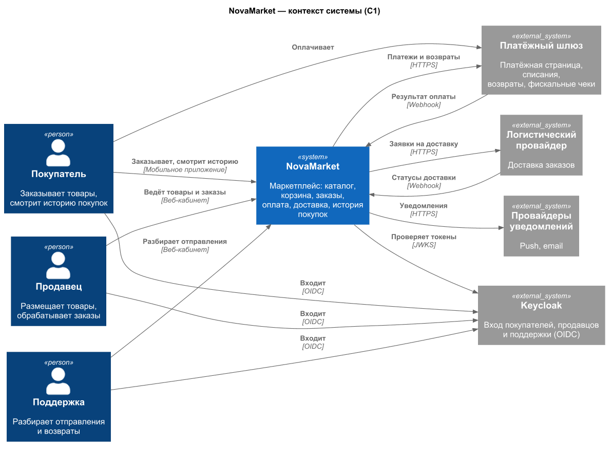
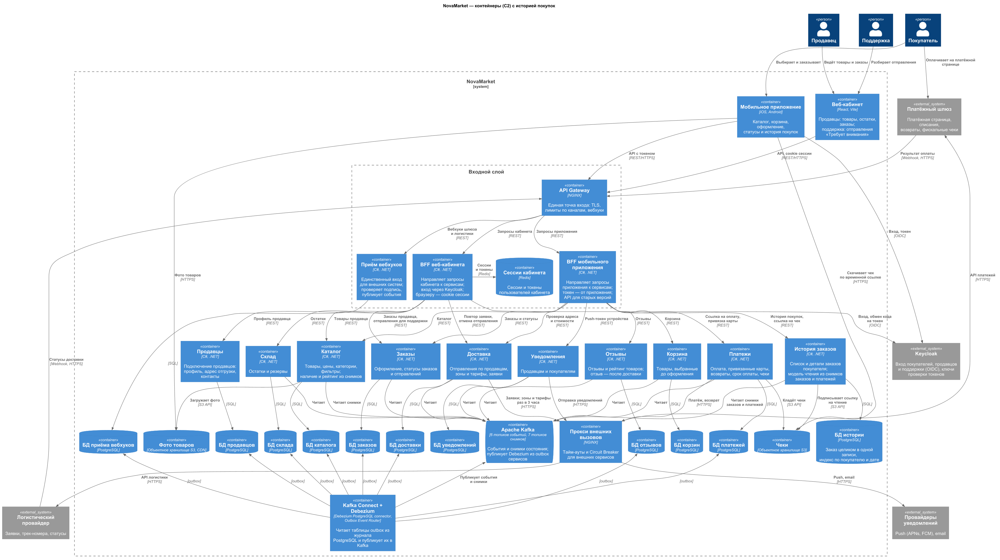
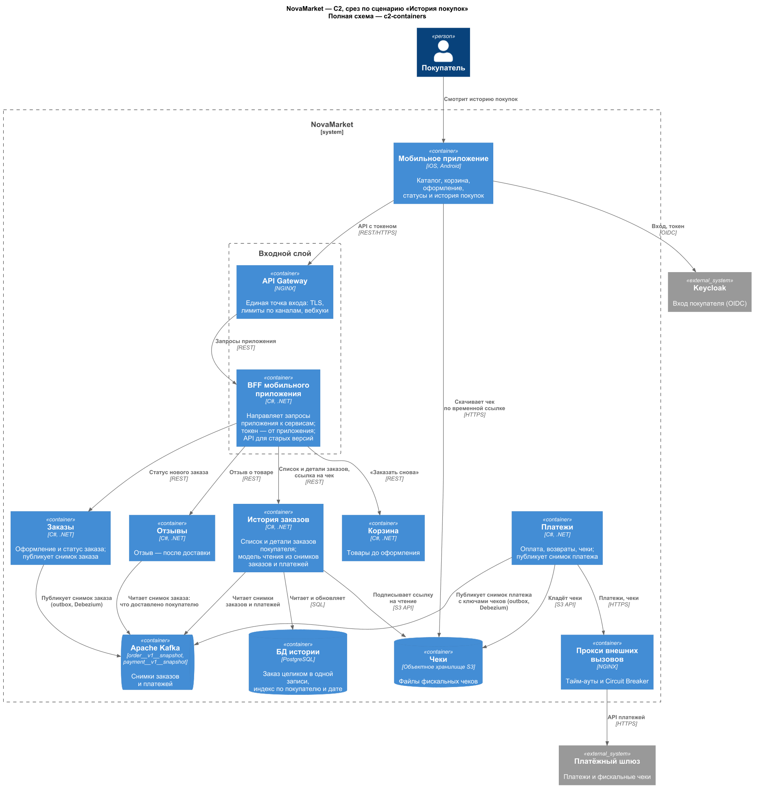

### **Название задачи:** История покупок покупателя
### **Автор:** Святослав Рожков
### **Дата:** 17.11.2026

Статус: принято.

Вклад ИИ в подготовку: [AI-LOG](../AI-LOG.md).

### **Контекст**

В MVP покупатель видит статус заказа, который отдаёт сервис заказов. Теперь нужна вся история покупок: список заказов, подробности по каждому, чек, отзыв о товаре и повторный заказ.

Данные заказа уже есть в снимке заказа `order__v1__snapshot` (задание 1). Сервис заказов публикует его при каждом изменении: позиции с названием и ценой на момент покупки, сумма, адрес, способы доставки и оплаты, отправления, статусы, трек-номера и даты. Не хватает только чеков. Фискальный чек формирует платёжный шлюз. Сервис платежей кладёт файл в своё объектное хранилище и после этого публикует снимок платежа в новый компактный топик `payment__v1__snapshot` с ключом по номеру заказа. В снимке — сумма, возвраты и ключи файлов чеков: чека оплаты и чеков возврата, если отправления отменялись. Ключ файла не меняется: исправленный чек ложится новым файлом.

### **Функциональные требования**

|**№**|**Действующие лица или системы**|**Use Case**|**Описание**|
| :-: | :- | :- | :- |
|1|Покупатель, мобильное приложение, сервис истории|Список заказов|1. Покупатель открывает «Мои покупки». 2. Приложение запрашивает первую страницу истории. 3. Сервис истории возвращает заказы покупателя, новые сверху: дата, сумма, способ доставки, статус. 4. При прокрутке приложение запрашивает следующую страницу|
|2|Покупатель, мобильное приложение, сервис истории|Детали заказа|1. Покупатель выбирает заказ. 2. Сервис истории возвращает товары с количеством и ценой на момент покупки, итоговую сумму, способы доставки и оплаты, отправления и финальный статус (доставлен, частично отменён, отменён)|
|3|Покупатель, сервис истории, хранилище чеков|Скачать чек|1. Покупатель нажимает «Чек» у оплаты или у возврата. 2. Сервис истории подписывает временную ссылку на файл. 3. Приложение скачивает файл прямо из хранилища|
|4|Покупатель, сервис отзывов|Оставить отзыв|1. В доставленном заказе покупатель нажимает «Отзыв» у товара. 2. Приложение открывает форму сервиса отзывов. 3. Сервис отзывов проверяет, что товар доставлен этому покупателю, и сохраняет отзыв|
|5|Покупатель, корзина|Заказать снова|1. Покупатель нажимает «Заказать снова». 2. Приложение передаёт товары и количества в корзину. 3. Цена и наличие проверяются заново при оформлении|
|6|Сервисы заказов и платежей, сервис истории|Обновление истории|1. Сервис заказов публикует снимок заказа, сервис платежей — снимок платежа. 2. Сервис истории обновляет по ним запись заказа|

### **Нефункциональные требования**

|**№**|**Требование**|
| :-: | :- |
|1|Отклик API истории: до 0,3 с для 98% запросов и до 1 с для 99,99%|
|2|Время ответа не растёт с объёмом данных: при 40 000+ заказов в день (около 15 млн за год) и с числом заказов у покупателя|
|3|Рост чтения истории и скачивания чеков не ухудшает отклик оформления заказа и оплаты|
|4|Покупатель видит только свои заказы и чеки: идентификатор покупателя берётся из токена|
|5|Сайт, чат-бот и другие будущие каналы используют тот же API|
|6|Новые данные в истории (возвраты, промо-акции) добавляются, не меняя сервисы оформления заказа и оплаты|

### **Решение**

Выбран CQRS: отдельный сервис «История заказов» со своей моделью чтения. Сервис читает из Kafka снимки заказов и платежей и хранит каждый заказ целиком в одной записи PostgreSQL (JSONB): команда уже работает с PostgreSQL, а запрос «заказы покупателя по дате» — обычная выборка по индексу. Запрос истории — одно чтение из своей базы, без обращений к другим сервисам.

Полная схема C2 с историей покупок ([c2-containers.puml](c2-containers.puml)):

Срез C2 по сценарию истории — только участвующие контейнеры ([c2-history.puml](c2-history.puml)):

Исходник C1: [c1-context.puml](c1-context.puml).

Как строится модель чтения:

| Источник | Что попадает в историю |
| :- | :- |
| `order__v1__snapshot` | Всё о заказе: дата, покупатель, позиции с названием, количеством и ценой на момент покупки, сумма, адрес, способы доставки и оплаты, отправления, статусы, трек-номера, даты |
| `payment__v1__snapshot` (новый компактный топик, ключ — номер заказа) | Ключи файлов чека оплаты и чеков возврата |

- У снимков заказа и платежа свои версии, история хранит обе. Снимок применяется, только если его версия новее сохранённой для этого источника, поэтому повторы и запоздавшие снимки ничего не портят. Снимки приходят в любом порядке: запись заказа заводится по первому из них.
- API: `GET /history?cursor=…` — список, `GET /history/{orderId}` — детали, `GET /history/{orderId}/receipts/{receiptId}` — временная ссылка на чек. Выборка идёт по индексу «покупатель + дата», курсор «дата + номер заказа» не замедляет дальние страницы у покупателей с длинной историей.
- Файл чека скачивается прямо из хранилища по временной ссылке на 15 минут. Ссылку подписывает история: у неё доступ к хранилищу чеков только на чтение. Ни история, ни платежи файл через себя не пропускают.
- Отзыв принимает сервис отзывов, «заказать снова» обрабатывает корзина.
- Только что оформленный заказ приложение открывает по номеру из ответа `202` в сервисе заказов: в историю он попадает через секунды.
- При первой сборке и при пересборке история читает с начала компактные топики снимков заказов и платежей: в них последняя версия каждого заказа и платежа вместе с ключами чеков.
- Нагрузку на чтение снимают реплики сервиса и реплики его базы.

### **Альтернативы**

#### Модель чтения внутри сервиса заказов

Сервис заказов отдаёт историю сам, читая с реплики своей базы, и дополнительно читает снимки платежей.

- Плюсы: данные уже есть, не нужен новый сервис, нет второй копии заказов. Реплика снимает нагрузку чтения с основной базы.
- Минусы: просмотр истории и оформление заказов живут в одном сервисе и выпускаются вместе. Схема базы заказов подстраивается сразу под смену статусов и под чтение длинных списков. Каждая новая деталь истории — возвраты, лояльность, промо — снова меняет сервис заказов.

По нагрузке справятся оба варианта, а для MVP этот дешевле. Отдельный сервис выбран, потому что историю будут пополнять новыми данными и развивать независимо от оформления.

#### API Composition

Метод истории берёт список и детали в сервисе заказов, а ссылку на чек по нажатию «Чек» — в сервисе платежей.

- Плюсы: просто, данные всегда актуальны, новый сервис не нужен.
- Минусы: чтение истории ложится на сервисы, через которые идёт оформление. Реплики снимут нагрузку, но база заказов всё равно подстраивается и под смену статусов, и под чтение длинных списков. Отклик истории зависит от сервиса заказов, а чека — ещё и от платежей. По сути это история внутри сервиса заказов, только с синхронными вызовами между сервисами.

По нагрузке этот вариант с репликами тоже справился бы. Он отвергнут из-за связанности: история зависела бы от доступности и выпусков сервисов заказов и платежей.

#### Event Sourcing в сервисе заказов

Заказ хранится как последовательность событий, история получается их проигрыванием.

- Плюсы: полная история изменений, можно восстановить состояние заказа на любой момент.
- Минусы: сервис заказов и его хранилище пришлось бы переделать, а для списка заказов всё равно нужна отдельная модель чтения. Требований к аудиту и восстановлению прошлых состояний нет.

**Недостатки, ограничения, риски**

- Заказ появляется в истории с задержкой в секунды; отставание обработки снимков мониторится.
- Новый сервис и новая база, данные заказа хранятся дважды.
- История зависит от формата снимков заказа и платежа; меняют его по правилам версий из задания 1.
- Компактный топик снимков заказов растёт примерно на 15 млн ключей в год, и пересборка истории читает его целиком. Пересборка — редкая операция: новая копия строится рядом с работающей и подменяет её после завершения.
- В снимке заказа есть персональные данные: получатель и адрес. Они лежат в Kafka бессрочно и копируются в проекции сервисов. Когда покупатель удаляет аккаунт, заказы публикуются новой версией снимка без персональных данных, и проекции перезаписывают свои копии.
- В сервис платежей добавляются хранилище чеков и снимок платежа.
