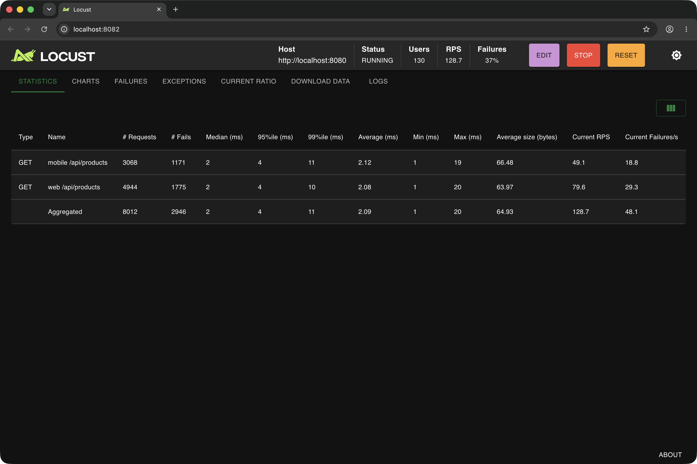
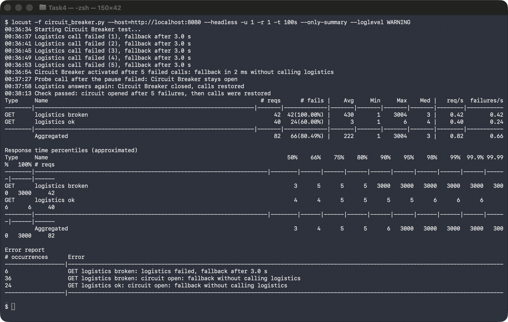

# Задание 4. Rate Limiter и Circuit Breaker на NGINX

| Файл | Что это |
| :- | :- |
| [nginx-rate-limiter.conf](nginx-rate-limiter.conf) | API Gateway: лимиты для веба и мобильного приложения, тестовый бэкенд |
| [nginx-circuit-breaker.conf](nginx-circuit-breaker.conf) | Прокси к логистике: тайм-аут, Circuit Breaker, fallback, тестовый сервер логистики |
| [slow.js](slow.js) | Задержка 5 с для `/slow` тестового сервера логистики |
| [rate_limiter.py](rate_limiter.py), [circuit_breaker.py](circuit_breaker.py) | Сценарии Locust |
| [results/](results/) | Скриншоты и логи прогонов |

## Часть 1. Rate Limiter

В исходной конфигурации у всех клиентов одна зона на 100 запросов в секунду с IP и `burst=200` без `nodelay`. До 200 лишних запросов встают в очередь и ждут до двух секунд, отклоняются только запросы сверх неё. Вместо быстрого отказа клиент ждёт.

Новая конфигурация:

- Две зоны: `web` — 50 запросов в секунду с IP, `mobile` — 30. Канал определяет заголовок `Client-Type`. Через `map` у запроса непустой ключ только в зоне своего канала, а запросы с пустым ключом NGINX не учитывает. Запрос без заголовка или с неизвестным каналом получает более строгий лимит мобильного приложения.
- Сверх лимита — `429 Too Many Requests` с `Retry-After: 1` и JSON вместо стандартного 503: клиент отличает лимит от сбоя и знает, когда повторить.
- `burst=10` для веба и `burst=6` для мобильного, с `nodelay`. Это пятая часть секундного лимита: короткая пачка параллельных запросов при открытии экрана проходит сразу, средний поток всё равно не выше лимита.

NGINX считает лимит методом leaky bucket ([документация](https://nginx.org/en/docs/http/ngx_http_limit_req_module.html)): 50 запросов в секунду — это один запрос в 20 мс, а не «любые 50 за секунду». Из пачки одновременных запросов проходят только первый и ещё `burst`. Поэтому пользователи в сценарии Locust делают паузу случайной длины, от 0,5 до 1,5 с, — как живые клиенты, а не синхронными залпами.

Ограничения:

- Заголовок `Client-Type` легко подделать: любой клиент может назваться веб-приложением и получить лимит 50 вместо 30. В рабочей системе канал определяют по ключу API или токену клиента.
- Вебхукам платёжного шлюза и логистики нужен отдельный location без лимитов по каналам: у них нет `Client-Type`, и мобильный лимит на IP им не подходит. Такой location закрыт списком разрешённых адресов, а ведёт он в сервис приёма вебхуков, который проверяет подпись запроса (HMAC): NGINX без дополнительных модулей подпись тела не проверит. В этой конфигурации location не показан.
- `$binary_remote_addr` — адрес того, кто подключился к NGINX. За балансировщиком нужен модуль `real_ip`, иначе все клиенты получат один общий лимит.
- Счётчики живут в памяти одного экземпляра NGINX. При нескольких репликах шлюза лимит клиента умножается на их число.

## Часть 2. Circuit Breaker

| Требование | Как сделано |
| :- | :- |
| Тайм-аут 3 с | `proxy_connect_timeout`, `proxy_send_timeout`, `proxy_read_timeout` по 3 с |
| Пять ошибок — пауза 30 с с fallback | `max_fails=5 fail_timeout=30s`, как в подсказке к заданию. Неудача — тайм-аут, обрыв соединения или ответ 500, 502, 503, 504 (`proxy_next_upstream`) |
| Fallback-ответ | `error_page` отдаёт из `@logistics_fallback` 503 с JSON и `Retry-After: 30` |
| После паузы вызовы восстанавливаются | Через 30 с NGINX пропускает к логистике один запрос. Успех — вызовы восстановлены, неудача — ещё 30 с паузы |

Как это устроено:

- В группе upstream два сервера: логистика и запасной сервер, который всегда отвечает 503. Он нужен, потому что с одним сервером в группе NGINX игнорирует `max_fails` и `fail_timeout` и никогда не считает сервер недоступным ([документация](https://nginx.org/en/docs/http/ngx_http_upstream_module.html#server)). Исходный upstream с одним сервером цепь не размыкал бы. Имя `localhost` из примера в задании здесь не подходит: в контейнере NGINX оно даёт два адреса, `127.0.0.1` и `::1`, а второй никто не слушает.
- `zone` даёт воркерам NGINX общий счётчик ошибок. Без неё каждый воркер считает ошибки сам, и цепь размыкается в разное время.
- `non_idempotent` разрешает передать POST следующему серверу после ошибки. Это безопасно: следующий сервер — заглушка, в логистику запрос повторно не уходит. Заодно ответы 5xx на POST начинают засчитываться неудачами — без этого создание заявок не размыкало бы цепь ([проверка запросами curl](results/circuit-breaker-post-check.txt)).
- Заголовок `X-Upstream` показывает, ходил ли прокси в логистику (`127.0.0.1:9090`). По нему сценарий Locust видит, что цепь разомкнута.
- `/slow` тестового сервера отвечал сразу, и тайм-аут на нём не проверить. Ответ задерживается на 5 с через [slow.js](slow.js) (модуль njs есть в официальном образе nginx).

Ограничения:

- NGINX считает не пять ошибок подряд. Успешные ответы между ошибками счётчик не обнуляют, его обнуляет только успешный запрос больше чем через 30 с после последней ошибки. Поэтому цепь разомкнётся и от пяти редких ошибок, если между соседними меньше 30 с.
- Тайм-ауты действуют по фазам: 3 с на соединение и 3 с между двумя чтениями ответа, а не на весь вызов. Медленное соединение вместе с медленным ответом или ответ по частям держат запрос дольше 3 с.
- Fallback одинаков для одиночной ошибки и для разомкнутой цепи, поэтому `Retry-After: 30` после одиночной ошибки — с запасом.
- Пока цепь разомкнута, каждый запрос пишет в error.log строку `no live upstreams`.
- Полуоткрытого состояния с несколькими пробными запросами и метрик состояния цепи нет. Если они нужны, Circuit Breaker ставят в сам сервис доставки (в .NET — `Microsoft.Extensions.Http.Resilience`), а за NGINX оставляют тайм-ауты.

## Часть 3. Проверка

Конфигурации запускались в официальном образе `nginx:1.29`, каждая по очереди на порту 8080:

```bash
docker run --rm -p 8080:8080 -v "$PWD/nginx-rate-limiter.conf:/etc/nginx/nginx.conf:ro" nginx:1.29
locust -f rate_limiter.py --host=http://localhost:8080 --web-port=8082 -u 130 -r 20

docker run --rm -p 8080:8080 -v "$PWD/nginx-circuit-breaker.conf:/etc/nginx/nginx.conf:ro" \
  -v "$PWD/slow.js:/etc/nginx/slow.js:ro" nginx:1.29
locust -f circuit_breaker.py --host=http://localhost:8080 --headless -u 1 -r 1 -t 100s --only-summary --loglevel WARNING
```

`rate_limiter.py` даёт 80 веб-клиентов и 50 мобильных, каждый в среднем по запросу в секунду. Отказ засчитывается как срабатывание лимита, только если пришёл 429 с `Retry-After: 1` и JSON; другие ошибки видны в отчёте Locust отдельно.

`circuit_breaker.py` первые 60 секунд обращается к сломанной логистике, потом к рабочей. Режим поломки задаёт `LOGISTICS_FAILURE`: `slow` — ответ дольше тайм-аута (по умолчанию), `error` — 503. Пользователь один, запросы идут по очереди: так видно, что цепь размыкается после пятой неудачи. В конце сценарий проверяет, что цепь разомкнулась после пяти неудач и вызовы восстановились, и завершается с кодом 0 или 1. `--only-summary` убирает промежуточные таблицы Locust, `--loglevel WARNING` — служебные строки.

Прогоны — 18 ноября 2026 года.

### Rate Limiter

Минута нагрузки с одного IP ([статистика Locust](results/rate-limiter-stats.csv)):

| Канал | Отправлено, запросов/с | Отклонено с 429, запросов/с | Пропущено, запросов/с | Доля отказов |
| :- | -: | -: | -: | -: |
| Веб | 77,3 | 27,8 | 49,5 | 36% |
| Мобильное | 48,1 | 18,4 | 29,7 | 38% |



Скриншот снят сразу после выгрузки CSV. Веб-интерфейс Locust обновляет счётчики раз в 2 с, поэтому запросов на нём чуть меньше.

Графики запросов и отказов — [rate-limiter-charts.png](results/rate-limiter-charts.png), все отказы — ответы 429 — [rate-limiter-failures.png](results/rate-limiter-failures.png).

Пачка из 20 одновременных запросов ([лог](results/rate-limiter-burst.txt)):

```bash
for i in $(seq 20); do curl -s -o /dev/null -w '%{http_code}\n' -H 'Client-Type: web' http://localhost:8080/api/products & done; wait
```

У веба проходит 11, у мобильного — 7, то есть первый запрос и ещё `burst`. Без заголовка `Client-Type` и с неизвестным каналом тоже проходит 7 — действует лимит мобильного приложения.

### Circuit Breaker

Режим `slow` ([лог](results/circuit-breaker-slow.log)):



Режим `error` даёт ту же последовательность, только неудачи приходят без ожидания тайм-аута ([лог](results/circuit-breaker-error.log)).
